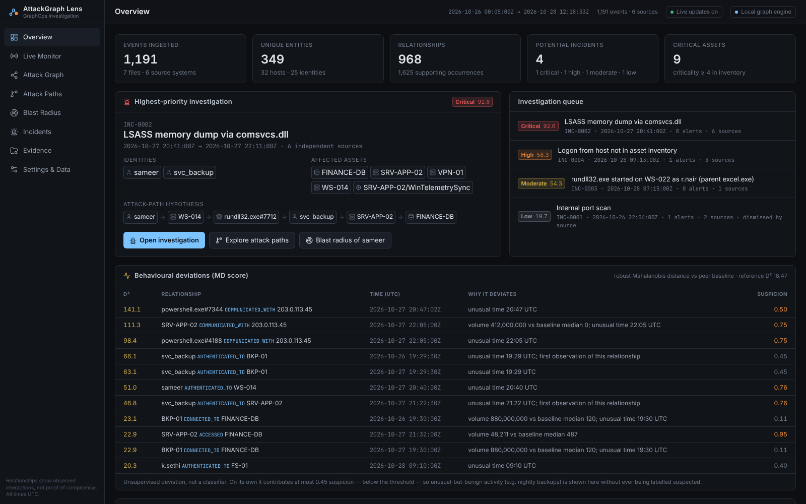
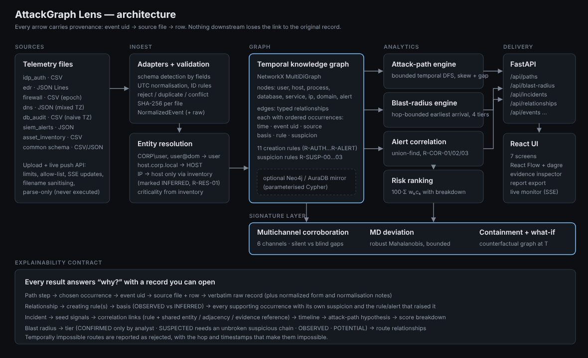
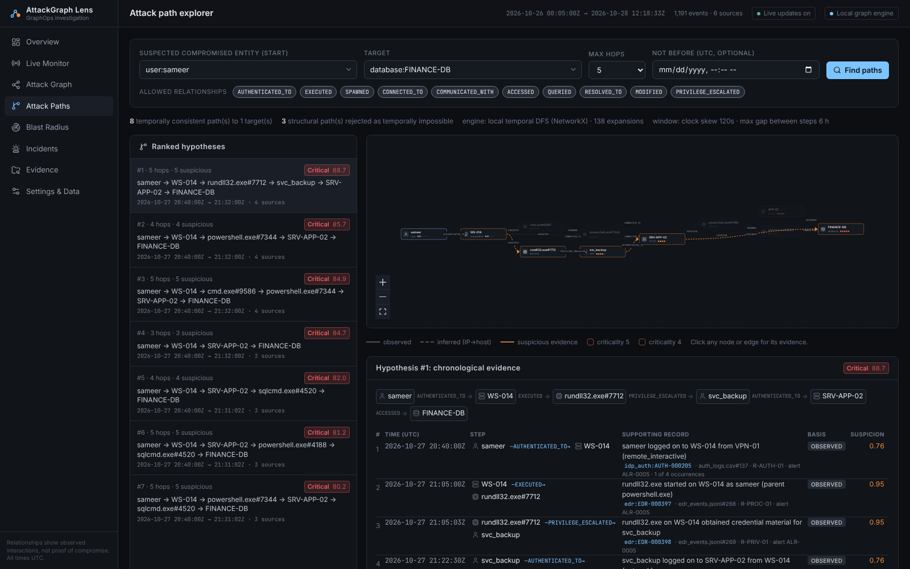
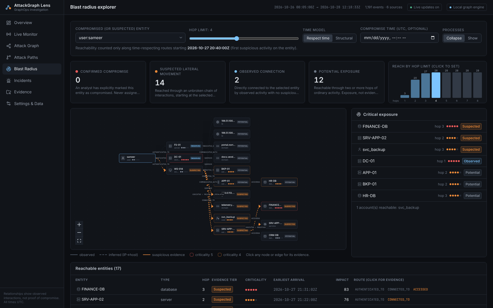
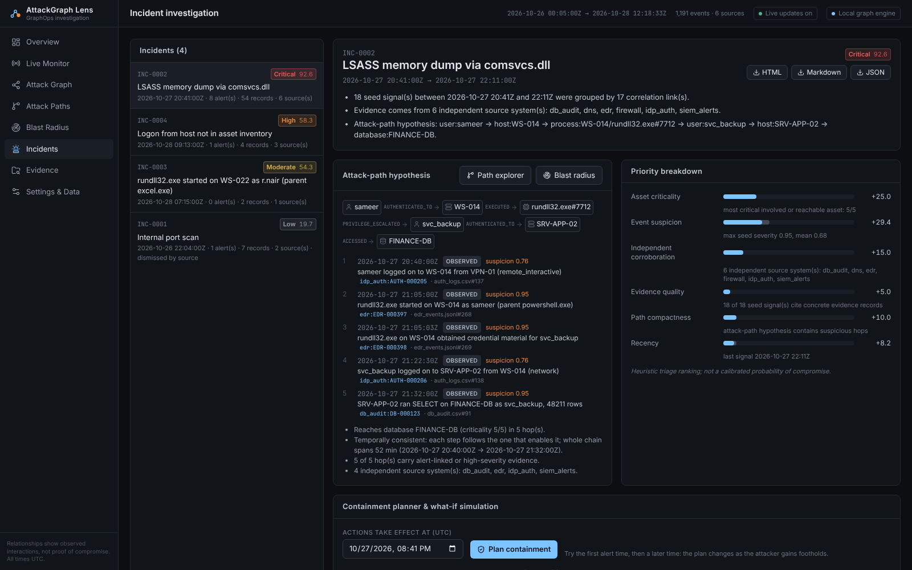
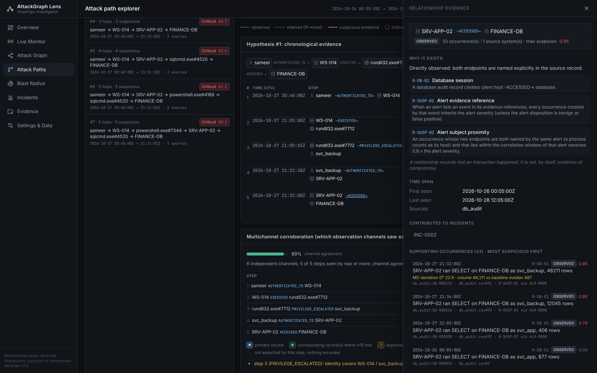
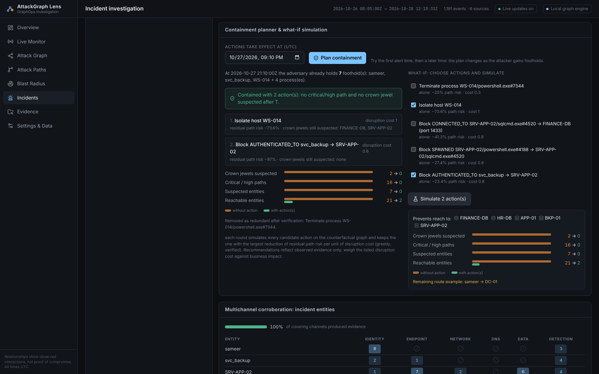
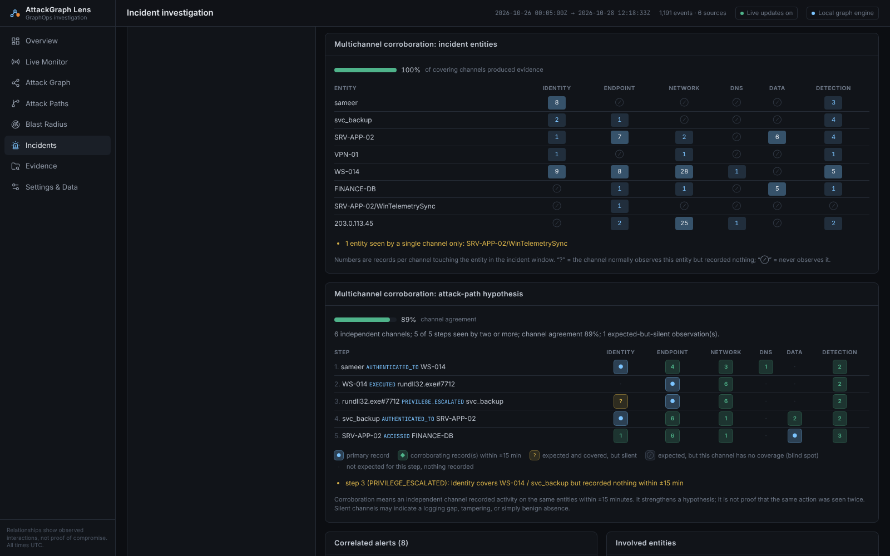
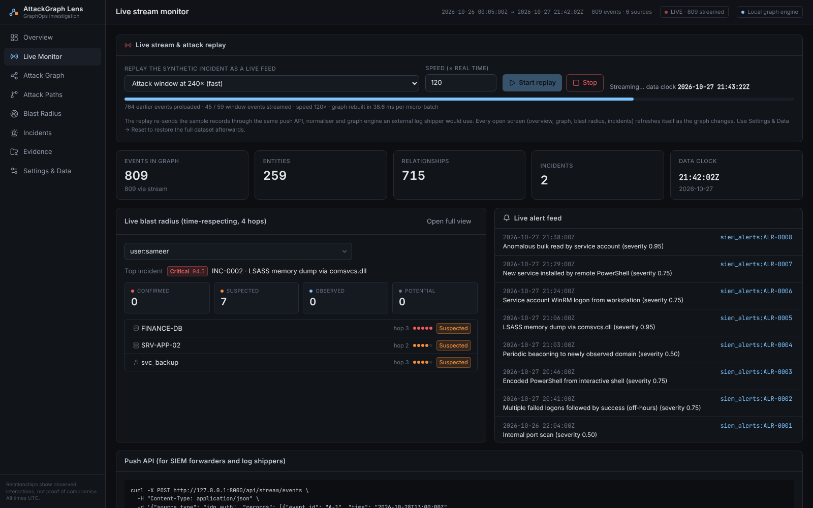
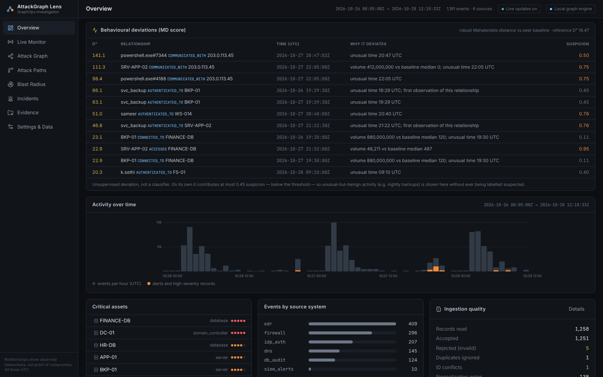

# AttackGraph Lens

**From fragmented security events to explainable attack paths and blast-radius intelligence.**

AttackGraph Lens is a graph-based threat-hunting and incident-investigation application built for
**hackFront India 2026 — Theme T-2 Cybersecurity, Problem T2.1 GraphOps**:

> *Build a graph engine for security teams that maps attack paths, shows the blast radius of a compromised
> system in real time, and turns scattered alerts into one clear incident picture.*

It ingests identity, endpoint, firewall, DNS, database-audit and SIEM records, builds a **temporal knowledge
graph** in which every edge keeps the events that justify it, and then answers three analyst questions:

| Question | Feature | What makes it trustworthy |
|---|---|---|
| *How could an attacker have got from here to the crown jewels?* | **Attack-path explorer** | Paths must be **time-consistent** (each step after the one that enables it). Structurally possible but temporally impossible routes are shown as *rejected*, with the reason. |
| *If this is compromised, what is exposed — right now?* | **Blast-radius explorer + live stream** | Events stream in through a push API; the graph updates in micro-batches and every open screen refreshes itself (Server-Sent Events). The hop slider recomputes instantly; every reached entity is placed in one of four explicit evidence tiers. Reachability is never presented as compromise. |
| *Which alerts belong together?* | **Incident correlation** | Alerts and high-severity records are grouped by three published rules; each link, score component and timeline entry cites its evidence. |
| *Which independent sources agree — and which are silent?* | **Multichannel corroboration** | Every step and incident entity is checked across six observation channels (identity, endpoint, network, DNS, data, detection), separating *silent* channels (covered but quiet) from *blind* ones. |
| *What do we cut, and when?* | **Containment planner + what-if** | Actions (isolate, disable, terminate, block) are simulated on a counterfactual graph at the decision time; the plan changes as the attacker gains footholds. |



---

## Contents
[Features](#features) · [Publish to GitHub](PUSH_TO_GITHUB.md) · [Architecture](#architecture) · [Quick start](#quick-start) · [Sample workflow](#sample-workflow) ·
[Neo4j](#neo4j-optional) · [Testing](#testing) · [Project layout](#project-layout) · [Limitations](#known-limitations) ·
[AI use & acknowledgements](#ai-use-disclosure-and-acknowledgements)

## Features

- **Multi-source ingestion** (CSV, JSON, JSON Lines) with schema detection, UTC normalisation of ISO/offset/naive/epoch
  timestamps, invalid-record rejection with reasons, exact-duplicate and ID-conflict detection, per-file SHA-256,
  20 MB upload limit, filename sanitising and parse-only handling (uploads are never executed).
- **Identity resolution with explicit identifiers only**: `CORP\Sameer`, `sameer@corp.local` → `user:sameer`;
  `ws-014.corp.local` → `host:WS-014`; an IP becomes a host *only* when the asset inventory assigns it, and such
  edges are marked **INFERRED**.
- **Temporal knowledge graph** (NetworkX): 8 entity types, 11 relationship types, each relationship aggregating
  ordered *occurrences* (time, event, source system, basis, creating rule, suspicion).
- **Temporal attack-path discovery**: bounded DFS over simple paths with clock-skew tolerance, a maximum gap between
  steps, hop limit, relationship filters, search budget, automatic crown-jewel targets, explainable ranking, rejected
  impossible routes and a comparison with the connectivity-only shortest path.
- **Blast radius**: hop-bounded earliest-arrival reachability from the first suspicious activity (or a chosen
  compromise time, or structurally), growth curve by hop, critical-asset exposure, impact ranking and four tiers:
  `CONFIRMED_COMPROMISE` (analyst only) · `SUSPECTED_LATERAL_MOVEMENT` · `OBSERVED_CONNECTION` · `POTENTIAL_EXPOSURE`.
- **Alert correlation** into incidents with start/end, identities, assets, supporting events, evidence sources,
  correlation links, attack-path hypothesis, timeline and priority.
- **Transparent risk ranking**: `score = 100 · Σ wₖ·cₖ`, six documented components, adjustable weights, full
  breakdown on every path and incident; explicitly *not* a probability.
- **Evidence & explainability**: click any node, edge, step or record to see why it exists, the rule that created it,
  every supporting record (file + row + verbatim original) and the incidents it contributes to.
- **Exports**: incident reports in HTML, Markdown and JSON; evidence manifest with SHA-256 of source files and exports.
- **Real-time live mode**: `POST /api/stream/events` accepts batches from SIEM forwarders or log shippers in any
  supported schema; the graph, suspicion, MD deviation and incidents are recomputed in micro-batches (≤ 0.4 s apart,
  ≈ 30–90 ms per rebuild on the sample) and pushed to browsers over Server-Sent Events, so the overview, graph, blast
  radius and incidents update while an attack unfolds. A built-in **attack replay** streams the sample intrusion
  event-by-event at a chosen speed (Live Monitor screen).
- **Multichannel corroboration analysis** (signature feature): step × channel and entity × channel matrices with
  primary / corroborating / silent / blind states, channel agreement, and evidence-gap statements
  ("Identity covers svc_backup but recorded nothing within ±15 min of the credential theft").
- **MD behavioural deviation score**: robust Mahalanobis distance of each interaction (time of day, data volume,
  relationship novelty) against its pair or relationship-type baseline, decomposed into per-factor contributions.
  It is capped below the suspicion threshold, so unusual-but-benign activity (nightly backups) is shown but can never
  by itself make anything "suspected".
- **Containment planner and what-if simulation**: counterfactual graph at a chosen time `T`, adversary footholds at
  `T`, greedy verified plan with redundancy pruning, before/after crown-jewel exposure, and an interactive simulator.
  On the sample: at the first alert one action (isolate WS-014) contains the intrusion; 30 minutes later the stolen
  service-account logon must also be blocked.
- **Optional Neo4j / AuraDB backend** — implemented and unit-tested against a recording driver; see [status](#neo4j-optional).

### What is new

Real-time streaming with live blast radius, time-correct paths with rejected impossible routes, evidence-tiered blast radius, **multichannel corroboration**,
a bounded **MD deviation** signal and **time-aware containment planning** — see [docs/NOVELTY.md](docs/NOVELTY.md)
for the precise list and what is standard technique.

## Architecture



Details: [docs/TECHNICAL_ARCHITECTURE.md](docs/TECHNICAL_ARCHITECTURE.md) · algorithms and formulas:
[docs/METHODOLOGY.md](docs/METHODOLOGY.md).

| Layer | Technology |
|---|---|
| Engine & API | Python 3.11+, FastAPI, Pydantic v2, NetworkX, NumPy (MD deviation) |
| Optional graph store | Neo4j 5 / AuraDB via the official `neo4j` driver |
| UI | React 19, TypeScript, Vite, Tailwind CSS 4, React Flow (`@xyflow/react`) + dagre layout, lucide icons |
| Tests | pytest, FastAPI TestClient, Playwright (Chromium), ruff |
| Delivery | Dockerfile, docker-compose, GitHub Actions CI |

Deviation from the brief: Pandas and Plotly are not used. All parsing is done with the standard-library `csv`/`json`
modules (row-level error reporting, no unsafe loaders) and the two small charts are plain SVG, so neither library
would add capability.

## Quick start

Requirements: **Python 3.11+**. Node.js 20+ is only needed to rebuild the UI (the submission ZIP already contains the
built UI in `frontend/dist`).

```bash
# Linux / macOS — one command (creates .venv, installs, builds UI if needed, starts the server)
./scripts/run_local.sh
# Windows PowerShell
powershell -ExecutionPolicy Bypass -File scripts\run_local.ps1
```

Then open **http://127.0.0.1:8000**. The synthetic dataset loads automatically.

Manual steps:

```bash
python -m venv .venv && source .venv/bin/activate      # Windows: .venv\Scripts\activate
pip install -r requirements.txt
cd frontend && npm ci && npm run build && cd ..          # skip if frontend/dist exists
cd backend && python -m attackgraph serve                # http://127.0.0.1:8000  (API docs: /api/docs)
```

Docker (not exercised in the build environment — see Limitations): `docker compose up --build`.

Headless use:

```bash
cd backend
python -m attackgraph analyze                            # incidents in the sample data
python -m attackgraph path user:sameer database:FINANCE-DB --hops 5
```

### Environment configuration

Copy `.env.example` to `.env`. All variables are optional; the default is the zero-configuration local engine.

| Variable | Default | Purpose |
|---|---|---|
| `AGL_GRAPH_BACKEND` | `memory` | `memory` or `neo4j` |
| `NEO4J_URI`, `NEO4J_USERNAME`, `NEO4J_PASSWORD`, `NEO4J_DATABASE` | — / `neo4j` | Neo4j or AuraDB connection |
| `AGL_MAX_UPLOAD_MB` | `20` | per-file upload limit |
| `AGL_MAX_RECORDS_PER_FILE` | `200000` | per-file record limit |
| `AGL_SAMPLE_DIR`, `AGL_EXPORT_DIR`, `AGL_FRONTEND_DIST` | repo paths | path overrides |

## Sample workflow

The synthetic organisation "Northwind Analytics" (3 days, 1,191 accepted events, 6 source systems + inventory) contains
an intrusion, benign look-alikes and planted data-quality problems. Full answer key:
[data/sample/EXPECTED_OUTCOMES.md](data/sample/EXPECTED_OUTCOMES.md).

0. **Live Monitor** — start *Attack window at 60×*: watch alerts arrive, INC-0002 appear and escalate to Critical,
   and FINANCE-DB flip to *Suspected* in the live blast radius as the 21:32 bulk read streams in. (Afterwards:
   Settings & Data → Reset to sample dataset.)
1. **Overview** — 4 candidate incidents; the top one is *Critical* (8 alerts, 6 independent source systems).
2. **Attack Paths** — start `user:sameer`, target `database:FINANCE-DB`. Top hypotheses:
   `sameer → WS-014 → powershell.exe#7344 → SRV-APP-02 → FINANCE-DB` (20:40–21:32 UTC, every hop suspicious) and a
   credential-theft variant through `svc_backup`. The finance web-app route exists too but ranks *Moderate* (no
   suspicious hops). Routes through the backup server are **rejected**: its database access happened before the
   attacker could reach it.
3. **Blast Radius** — `user:sameer`, drag the hop slider 1 → 4: FINANCE-DB becomes *Suspected lateral movement* at
   hop 3. Compare `user:a.verma` (IT admin): the same database is only *Potential exposure*.
4. **Evidence** — click any step: rule, occurrences, source file and row, verbatim record.
5. **Incidents** — INC-0002: correlation links, timeline, hypothesis, priority breakdown; export HTML/Markdown/JSON.
6. **Containment** — on INC-0002 the planner recommends *Isolate host WS-014* at 20:41Z. Change the time to 21:10Z:
   the dumped `svc_backup` credential is now a foothold, and the plan adds *Block svc_backup → SRV-APP-02*.
7. **Multichannel** — the path explorer and incident page show which channels saw each step; the credential-theft step
   is flagged because the identity channel stayed silent.
8. **Overview → Behavioural deviations** — the C2 beacon, 412 MB egress and 48,211-row read stand out; the nightly
   backup also deviates but stays below the threshold.

| Attack paths | Blast radius |
|---|---|
|  |  |
| **Incident** | **Evidence inspector** |
|  |  |
| **Containment planner & what-if** | **Multichannel corroboration** |
|  |  |
| **Live Monitor (real-time replay)** | **Behavioural deviations (MD)** |
|  |  |

A screen recording of the real application performing this workflow is in
`demo/attackgraph_lens_demo.mp4` (narration captions are overlaid by the recording script; everything else is live
output). See [demo/DEMO_SCRIPT.md](demo/DEMO_SCRIPT.md).

## Neo4j (optional)

The adapter (`backend/attackgraph/store/neo4j_store.py`) creates a uniqueness constraint and indexes, persists
entities as `:Entity:<Type>` nodes and relationships with their semantic type plus occurrence arrays (times, event
uids, sources, suspicion, basis), all through `UNWIND $rows` parameterised batches. In `neo4j` mode the path explorer
asks Neo4j for structural candidates with variable-length Cypher and validates them with the same temporal scheduler
as local mode, so ranking and explanations are identical.

```bash
# .env
AGL_GRAPH_BACKEND=neo4j
NEO4J_URI=neo4j+s://<your-instance>.databases.neo4j.io
NEO4J_USERNAME=<user>
NEO4J_PASSWORD=<password>
```

Restart, open **Settings & Data → Graph backend → Connect & sync to Neo4j**.

**Status: implemented and tested against a recording fake driver only.** No Neo4j server or AuraDB credentials were
available in the build environment (Docker Hub and neo4j.com downloads were blocked), so the adapter has **not** been
validated against a live database. Do not claim Neo4j partner-track qualification until it has been run and
demonstrated against AuraDB.

## Testing

```bash
pip install -r requirements-dev.txt
cd backend
pytest -m "not e2e"          # 99 unit, integration, API, live-stream and known-answer tests
python -m playwright install chromium && pytest -m e2e    # 6 browser tests (needs frontend/dist)
cd ../frontend && npm run typecheck
```

Last recorded run: **105 passed, 0 failed** (95 % statement coverage of `attackgraph/`). Details, test list and
measured timings: [docs/VALIDATION_REPORT.md](docs/VALIDATION_REPORT.md).

## Project layout

```
backend/attackgraph/      engine: ingest/, graph/ (builder, paths, blast), correlate, channels, deviation, containment, live,
                          risk, evidence, report, store/neo4j, api/
backend/tests/            pytest suites incl. known-answer, API, Neo4j-adapter and Playwright e2e tests
frontend/src/             React app: pages/ (7 screens), components/ (graph canvas, inspector, charts)
data/sample/              synthetic dataset + EXPECTED_OUTCOMES.md
scripts/                  data generator, screenshot capture, benchmark, run scripts
docs/                     architecture, methodology, validation, limitations, disclosure, development log, screenshots
demo/                     demo video, recording script, demo/narration scripts, sample incident report
submission/               hackFront activity-document draft (requires manual completion)
```

## Known limitations

Synthetic data only; no real-world detection-accuracy claim; Neo4j/Docker/CI not executed against live services;
single-process in-memory state; live mode recomputes the graph per micro-batch (fine at prototype scale, needs
incremental updates for very large streams); no authentication on the API (bind to localhost). Full list:
[docs/LIMITATIONS.md](docs/LIMITATIONS.md). Security policy: [SECURITY.md](SECURITY.md).

## AI-use disclosure and acknowledgements

This codebase, dataset generator, tests and documentation were produced with substantial assistance from an AI coding
assistant (Anthropic Claude) working under the team's direction during the hackFront league. It is a new
implementation and does not reuse code, data, results or material from the team's earlier projects. Details and the
complete third-party list with licences: [docs/AI_AND_THIRD_PARTY_DISCLOSURE.md](docs/AI_AND_THIRD_PARTY_DISCLOSURE.md).

Built on FastAPI, Pydantic, Uvicorn, NetworkX, NumPy, the Neo4j Python driver, React, React Flow, dagre, Tailwind CSS,
Vite, lucide, Inter and JetBrains Mono — thank you to their maintainers.

Licence: MIT (see [LICENSE](LICENSE)).
