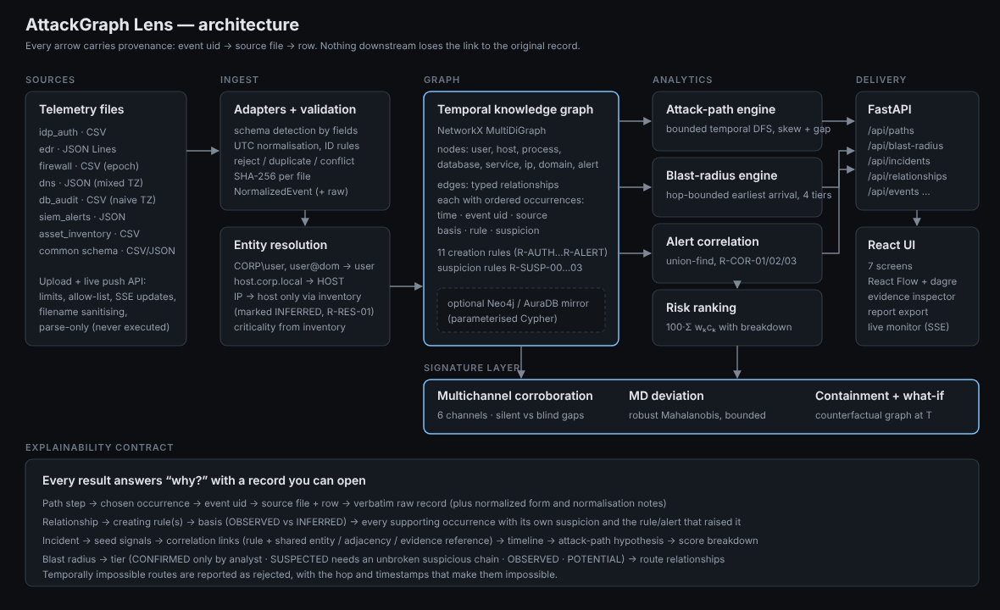

# Technical architecture



## 1. System overview

AttackGraph Lens is a single Python service (FastAPI) that owns an in-memory temporal graph and serves a React
single-page application. An optional Neo4j/AuraDB database can mirror the graph and generate path candidates.

```
Security event sources (CSV / JSON / JSONL)
  → Event ingestion & validation          ingest/loader.py, ingest/sources.py, ingest/normalize.py
  → Entity extraction & normalisation     graph/builder.py (endpoint resolution, inventory)
  → Temporal relationship graph           graph/builder.py (TemporalGraph)
  → Alert correlation                     correlate.py
  → Attack-path analysis                  graph/paths.py
  → Blast-radius engine                   graph/blast.py
  → Multichannel corroboration            channels.py
  → MD behavioural deviation              deviation.py (runs during graph build, rule R-SUSP-03)
  → Containment planning & what-if        containment.py (counterfactual graphs)
  → Real-time live mode                   live.py (push API, micro-batch rebuild, SSE, replay)
  → Explainability & provenance           evidence.py, rules.py, narrative.py
  → Investigation dashboard               api/app.py  +  frontend/src
  → Exportable investigation report       report.py
```

`workspace.py` is the application service: it holds loaded files, events, inventory, analyst dispositions,
settings and exports, rebuilds the graph after every ingestion, and caches incidents until data or settings change.
A re-entrant lock serialises mutations.

## 2. Data flow

1. **Upload/load** — bytes are read with a hard size cap, the file name is reduced to `[A-Za-z0-9._-]` with directory
   components stripped, the extension must be `.csv/.json/.jsonl/.ndjson`, content must decode as UTF-8, record count
   is capped. JSON is parsed with `json.loads`; CSV with `csv.DictReader`. Nothing is executed or unpickled.
2. **Adapter detection** — the first record's field names are matched against each adapter's signature (most specific
   first) unless the user chooses a source type.
3. **Per-record mapping** — required fields, enumerations, IP syntax and timestamps are validated; failures reject the
   record with a row-numbered reason. Records without ids get `h-<sha256 prefix>` of their content.
4. **De-duplication** — within a file and across files by `uid = source_system:event_id`: identical content →
   *duplicate* (ignored); different content → *conflict* (first copy kept, flagged).
5. **Graph build** — inventory first (criticality, categories, IP→host map), then events in time order through the
   relationship rules, then alert context edges, then suspicion propagation. Occurrence lists are sorted and a
   timestamp index per relationship is kept for binary search.
6. **Analysis on demand** — paths and blast radius are computed per request; incidents once per graph/settings version.

## 3. Entity schema

| Field | Notes |
|---|---|
| `id` | `<type>:<name>`, e.g. `user:sameer`, `host:WS-014`, `process:WS-014/powershell.exe#7344`, `database:FINANCE-DB`, `ip:203.0.113.45` |
| `type` | `user`, `host`, `ip`, `process`, `database`, `service`, `domain`, `alert` |
| `category` | `workstation`, `server`, `domain_controller`, `network_device`, `user`, `service_account`, `admin_account`, `external`, `internal_unmanaged`, `unmanaged`… |
| `criticality` | 1–5 from inventory; non-inventoried databases default to 3; everything else 1 |
| `in_inventory`, `attributes` | inventory reference (`file#row`), owner, tags, IP, process image/PID/command line |
| `first_seen`, `last_seen` | from supporting records |

Identity resolution uses explicit identifiers only: domain prefixes/suffixes and case are normalised for users;
FQDN suffixes and case for hosts; IP→host only through inventory assignment. There is no fuzzy matching.

## 4. Relationship schema

`Relationship(id = "<src>|<TYPE>|<dst>", source, target, type, occurrences[])`

`Occurrence(event_uid, timestamp, source_system, basis ∈ {observed, inferred}, rule, suspicion, attributes)`

Derived properties: `first_seen`, `last_seen`, `basis` (observed if any occurrence is observed), `max_suspicion`,
`sources`. Types and creation rules: see [METHODOLOGY.md §1](METHODOLOGY.md). `ALERTED_ON` is a context type and is
never traversed by path or blast-radius search.

## 5. Temporal model

Time lives on occurrences, not on entities or relationships. A relationship that happened 33 times keeps 33
timestamped occurrences, so a query can ask *"was this interaction possible after time t?"* with a binary search.
All timestamps are timezone-aware UTC; naive timestamps are assumed UTC and flagged; offset timestamps are converted
and flagged. The UI displays UTC everywhere.

## 6. Graph algorithms

| Need | Algorithm | Bound |
|---|---|---|
| Attack paths | DFS over simple paths with feasible-arrival-set propagation | `max_hops ≤ 8`, expansion budget, candidate cap |
| Connectivity baseline | NetworkX `shortest_path` on a traversable-edge subgraph view | — |
| Blast radius | hop-bounded label-correcting earliest-arrival search | `hops ≤ 8` |
| Correlation | union-find over time-sorted seeds within a sliding window | O(seeds × window) |
| Hubs | distinct infrastructure-neighbour count vs median | — |
| MD deviation | robust (median/MAD) standardisation, shrunk covariance, Mahalanobis D² with per-feature decomposition (NumPy) | per pair / relationship type |
| Multichannel | per-(entity, channel) sorted time index, binary-search windows | ±15 min per step |
| Containment | counterfactual graph copy + greedy simulation-based set cover + pruning | ≤ 5 actions |

## 7. Evidence provenance

`evidence.py` builds the explanations served by `/api/entities/{id}`, `/api/relationships/{id}` and
`/api/events/{uid}`: why the element exists (inventory or rule text), every occurrence with its file/row, basis,
rule, suspicion rule and alert, the verbatim raw record, the normalized form, the elements created by a record,
alerts citing it, unresolved alert references and incidents it supports. `build_manifest` lists SHA-256 digests of
source files and exported reports.

## 8. Database design (Neo4j, optional)

```
(:Entity:User|Host|Database|Process|Service|Domain|Ip|Alert {id, name, type, category, criticality, in_inventory, first_seen, last_seen})
-[:AUTHENTICATED_TO|EXECUTED|SPAWNED|CONNECTED_TO|COMMUNICATED_WITH|ACCESSED|QUERIED|RESOLVED_TO|MODIFIED|PRIVILEGE_ESCALATED|ALERTED_ON
  {id, times[], events[], sources[], max_suspicion, basis, count, first_seen, last_seen, traversable}]->
```

- `CREATE CONSTRAINT entity_id … REQUIRE e.id IS UNIQUE`; indexes on `type` and `criticality`.
- Sync: `UNWIND $rows … MERGE` in batches of 500. Labels and relationship types come only from enumerations;
  values only from parameters; hop bounds are validated integers 1–8.
- Candidate paths: `MATCH p = (s:Entity {id:$source})-[*1..k]->(t:Entity {id:$target}) WHERE all(r IN relationships(p) WHERE r.traversable) AND <no repeated node> RETURN [r IN relationships(p) | r.id] LIMIT $limit`.

Why a graph store fits: the questions are traversals of variable depth across heterogeneous entities; in a relational
model each hop is a self-join whose count is unknown in advance. Neo4j makes the traversal native and lets the
temporal check stay in one tested code path.

## 9. API

`GET /api/health · /api/summary · /api/rules · /api/sources · /api/datasets · /api/entities[/{id}] ·
/api/relationships/{id} · /api/graph · /api/blast-radius/{id} · /api/incidents[/{id}] · /api/incidents/{id}/report ·
/api/events[/{uid}] · /api/evidence/manifest · /api/settings · /api/backend · /api/incidents/{id}/containment ·
/api/deviations`
`POST /api/datasets/sample · /api/datasets/clear · /api/datasets/upload · /api/paths · /api/entities/{id}/status ·
/api/settings/reset · /api/backend/neo4j/sync · /api/whatif · /api/stream/events · /api/stream/flush ·
/api/stream/replay · /api/stream/replay/stop` · `GET /api/stream/status · /api/stream/updates` (Server-Sent Events) ·
`PUT /api/settings`. OpenAPI docs at `/api/docs`.

## 10. Security controls

| Control | Implementation |
|---|---|
| Upload validation | extension allow-list, bounded read (`max+1` bytes), size and record caps, UTF-8 check, schema detection |
| Path traversal | `sanitize_filename` strips directories and unsafe characters; uploads are processed in memory and never written under user-chosen paths; static UI serving checks the resolved path stays inside `dist` |
| No code execution / unsafe deserialisation | stdlib `csv` and `json` only; no `pickle`, `eval`, `yaml.load` |
| Secrets | environment variables / `.env` (git-ignored); Neo4j password excluded from model `repr`; connection errors report the exception class only |
| Parameterised queries | all Cypher values are parameters; labels/types from enums; hop bounds validated |
| Resource limits | hop limit 8, search budget, candidate cap, graph view limit (600 nodes), events page ≤ 1000, ≤ 12 files per upload |
| Error handling | domain errors → 4xx with a message; unexpected errors → 500 with a reference id, details only in the server log |
| HTTP headers | `X-Content-Type-Options: nosniff`, `X-Frame-Options: DENY`, `Referrer-Policy: no-referrer`; CORS limited to the Vite dev origin |
| Exports | HTML reports escape every value and contain no script |

Not implemented (documented in LIMITATIONS): authentication/authorisation, TLS termination, multi-user isolation.
